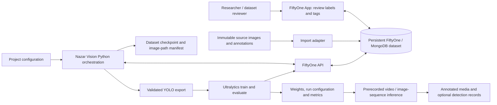

# Nazar Vision - Architecture and Project Setup

| Document control | Value |
| --- | --- |
| Version | 0.1, design baseline |
| Date | 18 October 2026 |
| Status | Proposed architecture; existing codebase not yet available for audit |
| Source | [Nazar Vision project brief](reference/Nazar_Vision_Project_Brief.pdf), especially pp. 4-16, 25-29 |
| Related documents | [SRS](Nazar_Vision_Software_Requirements_Specification.md), [ERD](Nazar_Vision_Entity_Relationship_Model.md), [workflows](Nazar_Vision_User_Usage_Workflows.md) |

## 1. Engineering objective and boundary

The graduation core is a reproducible **local Python research workflow**, not a new web platform. A user imports and reviews annotated images in FiftyOne, prepares a validated YOLO export, trains and evaluates an Ultralytics model, inspects predictions in FiftyOne, and runs inference on prerecorded video or an image sequence. The existing Nazar Vision repository is expected to provide some starting functionality, but it is not present in this folder. Integration details below are proposed until that repository is reviewed. (Brief, pp. 3-5, 7-16.)

The system boundary contains Python orchestration and configuration, the FiftyOne working dataset and App, its persistent MongoDB storage, local source images, YOLO exports, model artifacts, experiment reports, and prerecorded inference outputs. FiftyOne and Ultralytics should perform the operations they already support; Nazar Vision should provide the thin integration, validation, reproducibility, and recovery logic needed for this use case. (Brief, pp. 4-5.)



This diagram is a **target integration**. It does not assert that these components have already been implemented. There is no second application database in the core design. Source, reviewed, canonical, and prediction annotations are distinct fields in the same FiftyOne working dataset. (Brief, pp. 8-9, 14.)

## 2. Responsibility boundaries

| Responsibility | Preferred owner | Required behavior |
| --- | --- | --- |
| Image/annotation inspection and editing | FiftyOne App and API | Edit `ground_truth_reviewed`; keep `ground_truth_source` unchanged; edit sample tags in the same dataset. (pp. 8-10) |
| Persistent working state | FiftyOne/MongoDB | Reopen edited annotations, tags, canonical labels, and metadata across sessions. (pp. 12-13) |
| Source ingestion | Nazar Vision adapter using FiftyOne | Import original image references, annotations, and original splits without changing source files. (p. 8) |
| Canonical label projection | Small Nazar Vision function using FiftyOne | Apply configured reviewed-to-canonical mapping; regenerate on request and before export; reject unknown labels. (pp. 10-11) |
| Pre-export checks | Nazar Vision using FiftyOne queries | Detect missing/conflicting assignment tags, invalid boxes/classes, and exclusions; report actionable sample IDs. (p. 12; report format proposed) |
| Backup and restore | Nazar Vision runbook/automation around the selected MongoDB or FiftyOne method | Checkpoint before training/evaluation export, support manual checkpoints, periodically checkpoint after significant edits, and test restoration with image paths. (pp. 12-13) |
| YOLO export | FiftyOne/Ultralytics-compatible exporter | Use current validated tags and canonical annotations; omit `excluded` samples. (pp. 11-14) |
| Model training and evaluation | Ultralytics, with Nazar Vision run manifests | Save weights, configuration, metrics, and data-state reference; write predictions to a run-specific FiftyOne field. (pp. 13-15, 26) |
| Video processing | Ultralytics and optionally OpenCV | Load saved weights, process prerecorded frames, and save viewable annotated output with boxes and scores. (p. 15) |
| Code quality | Existing project tooling | pytest, Ruff, Black, mypy, and developer documentation. (pp. 4, 15-16) |

## 3. Data lifecycle and invariants

1. **Original source:** keep downloaded images and annotation files immutable. Record provider, dataset version, license, export date, source path, and preferably file hashes in a provenance manifest. The brief specifies IFPE's Roboflow Universe `Sea Turtles Hatchling Detection`, version 24, 694 images, CC BY 4.0, YOLO format, exported 1 October 2026; verify these against the actual download. (pp. 5-6.)
2. **Working dataset:** import into one persistent FiftyOne dataset. Preserve original boxes in `ground_truth_source`. Copy them into editable `ground_truth_reviewed`. Manage `train`, `val`, `test`, and `excluded` as sample tags. Review may change tags and boxes in any order. (pp. 8-10, 12.)
3. **Canonical projection:** map `sea turtle` to `hatchling` and `non-sea-turtle` to no positive annotation for the initial task. A sample with no hatchling box may still be a useful background image. Canonical labels can temporarily be stale during review; refresh on explicit request and always immediately before export. Unknown reviewed labels are errors. (pp. 6, 10-11.)
4. **Validation:** before export, every sample needs exactly one assignment tag. Reject missing or conflicting tags, unexpected classes, invalid bounding boxes, and any other condition that prevents a trustworthy export. Excluded samples remain visible in FiftyOne but are not exported. (p. 12.)
5. **Leakage control:** investigate exact duplicates, transformed/near duplicates, and frames from the same video, camera sequence, or nesting event across splits. Correct identified overlap and document unresolved uncertainty. Do not claim that a hash check alone proves split independence. (pp. 6, 12, 25-26.)
6. **Snapshot and export:** after regenerating canonical labels and passing validation, checkpoint the working dataset immediately before exporting for training or evaluation. Freeze a manifest linking the checkpoint, resolved source-image inventory, canonical mapping, split assignments, code revision, and export path. The manifest format is a proposed implementation choice; capturing recoverable state is required. (pp. 12-14, 26.)
7. **Experiments:** train with the selected training/validation data, reserve held-out test for final independent assessment, record parameters and outcomes, and store predictions separately for each evaluation run. (pp. 13-15, 26.)

## 4. Proposed workspace layout

The following layout separates the documents already created here from future runtime assets. The existing repository may use different paths; reconcile them during the initial audit instead of restructuring working code blindly.

```text
engineering_design_I/
  README.md
  .gitignore
  docs/
    Nazar_Vision_Software_Requirements_Specification.md
    Nazar_Vision_Entity_Relationship_Model.md
    Nazar_Vision_User_Usage_Workflows.md
    Nazar_Vision_User_Feature_Catalog.md
    Nazar_Vision_Architecture_and_Project_Setup.md
    Nazar_Vision_Requirements_Traceability.md
    Nazar_Vision_Assumptions_and_Open_Decisions.md
    diagrams/Nazar_Vision_Conceptual_ERD.mmd
    reference/Nazar_Vision_Project_Brief.pdf
  config/
    Nazar_Vision_Configuration_Example.yaml
  data/       # local raw images and generated YOLO exports; not supplied
  artifacts/  # future weights, evaluation, predictions, annotated media
  backups/    # future restorable MongoDB/FiftyOne checkpoints
```

`data/`, `artifacts/`, and `backups/` each include a short README; their future large contents are ignored by Git. The configuration file is deliberately an **example**, not a claim about the existing repository's executable schema.

## 5. Configuration and experiment manifest

At minimum, the eventual implementation needs explicit configuration for field names, label mapping, assignment tag names, source paths, export paths, model choice, and training parameters. The brief gives an example of the core field mapping; see [the example YAML](../config/Nazar_Vision_Configuration_Example.yaml). If an `adult_turtle` extension is selected, add it to the reviewed label vocabulary and canonical mapping only after its training data has been reviewed. (Brief, pp. 10-11, 18-19.)

**Proposed experiment manifest fields:** stable run ID; timestamp; code commit; dataset checkpoint and export IDs; source-data provenance; mapping/configuration file hash; split counts; model architecture and pretrained weights identifier; library versions; random seed; training settings; machine/GPU description; metric settings (confidence and IoU conventions); output paths; known data limitations. A manifest lets a future developer reconstruct why two model results differ. The brief requires reproducible important experiments but does not prescribe a manifest schema. (pp. 13-14, 26.)

## 6. Setup sequence once repository access is provided

| Step | Action | Completion evidence |
| --- | --- | --- |
| 1. Repository audit | Obtain the existing Nazar Vision repository, read its docs/licensing/configuration, identify implemented/incomplete functions, and map code to SRS requirements. | Updated [traceability matrix](Nazar_Vision_Requirements_Traceability.md) with actual status and owners. |
| 2. Environment | Confirm supported OS, Python and package versions, uv project definition, GPU/CPU constraints, FiftyOne/MongoDB operation, and Ultralytics model availability. | Clean environment installation and a small import/inference smoke run. |
| 3. Dataset provenance | Download the approved public dataset; verify version, 694-image claim, classes, licensing, files, and source partitions; preserve an immutable copy. | Source manifest with counts, paths, and checksums. |
| 4. Working dataset | Import to a persistent FiftyOne dataset, create the reviewed field, configure its Annotation Schema for direct edits, and verify source annotations are read-only. | Reopen after a test edit; confirm reviewed edit and tags persist while originals remain unchanged. |
| 5. Integrity and recovery | Implement split/box/class validation, duplicate investigation, pre-export checkpointing, manual checkpointing, and a restore procedure. | Negative test cases and an actual restore showing images, tags, annotations, and metadata. |
| 6. Training | Regenerate canonical labels, validate, export, train/fine-tune a suitable YOLO model, save weights/configuration. | Reproducible run manifest and reloadable weights. |
| 7. Evaluation | Evaluate on validation during development; write per-run predictions to FiftyOne; inspect errors; use held-out test for final assessment. | Metric report and representative false-positive/false-negative examples. |
| 8. Demonstration | Load weights and run prerecorded footage or an image sequence; produce annotated output. | Viewable media and documented source/limitations. |
| 9. Quality and handoff | Run relevant pytest, Ruff, Black, and mypy checks; complete operating and restore docs. | Passing agreed checks and a developer-followable runbook. |

The brief suggests `uv`, `pytest`, Ruff, Black, and mypy but does not supply a package lockfile or exact commands in this workspace. Select commands after inspecting the actual repository. (Brief, pp. 4-5, 15-16.)

## 7. Delivery gates and milestones

| Gate | Minimum evidence | Source alignment |
| --- | --- | --- |
| G1 - data trust | Source preserved; reviewed field and tags persist; dataset issues and leakage review recorded. | pp. 6-12 |
| G2 - recovery | Manual and automatic pre-export checkpoints; successful restore with image paths. | pp. 12-13 |
| G3 - trainable export | Canonical labels refreshed; invalid data blocks export; current splits honored; excluded images omitted. | pp. 10-14 |
| G4 - evaluated detector | Reloadable hatchling weights; precision, recall, mAP and error analysis; independent test governance. | pp. 13-15, 25-27 |
| G5 - demonstration and handoff | Annotated prerecorded media; tests and technical instructions; known limitations explained. | pp. 15-16, 27-29 |

The source brief lists an indicative October 2026 to June 2027 schedule and a desired conservation-organisation demonstration by May 2027; university dates and the one- or two-term assignment need confirmation. These gates are more reliable than assuming optional extensions will be finished by a calendar date. (Brief, pp. 27-29.)

## 8. Operational constraints and future deployment

- A good public-dataset score is evidence for the evaluated dataset, not proof of dependable nighttime beach detection. No fixed accuracy percentage is specified for the core project. (Brief, pp. 26-27, 29.)
- Real conservation-site footage, physical cameras, live feeds, tracking, and alerts are optional or future work. Any real site installation requires permissions and conservation guidance; lighting must not disturb turtles. (Brief, pp. 17-25, 29-31.)
- The future software release license remains undecided. Check dataset and dependency licenses and obtain appropriate review of the proposed prohibited uses before public release. (Brief, pp. 29, 31.)
- **Proposed practice:** keep local secrets out of the repository, restrict access to MongoDB and backups, and retain field footage only under an agreed policy if such footage is obtained. These are engineering recommendations, not additional core requirements from the brief.

See [Assumptions and Open Decisions](Nazar_Vision_Assumptions_and_Open_Decisions.md) for decisions needed before implementation is finalized.
