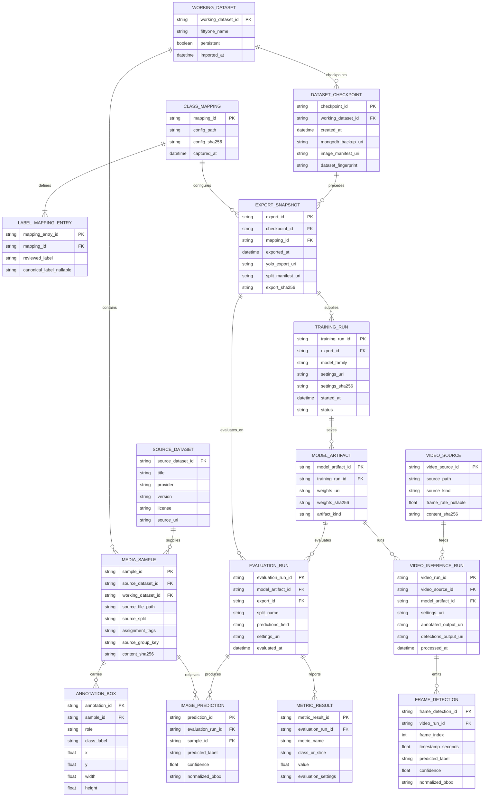

# Nazar Vision — Entity Relationship Model

**Document version:** 1.0  
**Date:** 18 October 2026  
**Status:** Proposed core proof-of-concept data design  
**Source:** [Nazar Vision project brief](reference/Nazar_Vision_Project_Brief.pdf)

## 1. Purpose and boundary

This document defines the conceptual and logical data model for the required hatchling-detection proof of concept: dataset import and review, canonical label preparation, reproducible YOLO training, image evaluation, and prerecorded video inference. It is **not a proposal for a new SQL database**. The working images, annotation fields, tags, and imported evaluation predictions belong to **one persistent FiftyOne dataset backed by MongoDB**. Configuration, backups, YOLO exports, model weights, metrics, and video outputs are versioned files or artifacts around that dataset. The brief explicitly identifies the annotation fields and tags as properties of the same dataset. [Specification, pp. 8–9](reference/Nazar_Vision_Project_Brief.pdf#page=8)

The model separates **logical identity and lineage** from storage choices. A logical entity such as `ANNOTATION_BOX` may be embedded in a FiftyOne sample field rather than stored in its own collection. IDs and foreign keys in the diagram express traceability, not a requirement to implement SQL tables. Optional tracking, alerts, live feeds, and camera integration are outside the core model. [Specification, pp. 15, 17, 20–24](reference/Nazar_Vision_Project_Brief.pdf#page=15)

## 2. Conceptual ERD

The complete, editable Mermaid diagram is [Nazar_Vision_Conceptual_ERD.mmd](diagrams/Nazar_Vision_Conceptual_ERD.mmd). Mermaid cardinality notation uses `||` for exactly one, `o{` for zero or many, and `|{` for one or many. A completed run can have stricter conditions than an in-progress run; those conditions are listed in Section 5.

## 3. Entity dictionary

| Logical entity | Purpose and minimum attributes | Persistence / identity |
|---|---|---|
| `SOURCE_DATASET` | Dataset provenance: provider, title, version, license, source location. The initial source is IFPE's Roboflow *Sea Turtles Hatchling Detection*, version 24, with 694 images and a CC BY 4.0 license. | Import manifest or FiftyOne dataset/sample metadata. Its ID is a project-assigned provenance key. [Specification, pp. 5–6](reference/Nazar_Vision_Project_Brief.pdf#page=5) |
| `WORKING_DATASET` | The named, persistent FiftyOne dataset used for review. `persistent` must be true. | FiftyOne/MongoDB dataset identity; one working dataset can import samples from multiple source datasets. [Specification, pp. 8–9, 12](reference/Nazar_Vision_Project_Brief.pdf#page=8) |
| `MEDIA_SAMPLE` | One imported image, its immutable source file path, current FiftyOne tags, imported split provenance, and optional grouping/hash metadata for duplicate or leakage checks. `assignment_tags` is a conceptual view of `sample.tags`, not a second editable assignment store. | FiftyOne sample; use its native sample ID as the logical key. Image bytes remain in the source files. [Specification, pp. 6, 8–9, 12–13](reference/Nazar_Vision_Project_Brief.pdf#page=6) |
| `ANNOTATION_BOX` | One object-detection label and normalized bounding box attached to a sample. `role` is `source`, `reviewed`, or `canonical`; these correspond to the three distinct FiftyOne fields. A sample may have zero boxes in a role. | Embedded FiftyOne `Detection` values in `ground_truth_source`, `ground_truth_reviewed`, or `ground_truth_canonical`; use native detection IDs where available. [Specification, pp. 8–11](reference/Nazar_Vision_Project_Brief.pdf#page=8) |
| `CLASS_MAPPING` | Versioned project configuration for label-field names and canonical mapping. Its file path and hash bind an export to the precise rules applied. | Configuration file plus export/run manifest, not a database table. [Specification, pp. 10–11, 26](reference/Nazar_Vision_Project_Brief.pdf#page=10) |
| `LABEL_MAPPING_ENTRY` | One reviewed label mapped to a canonical class or `null`. Initially `sea turtle → hatchling` and `non-sea-turtle → null`. `null` removes the positive box, not its image. | Entry in the mapping configuration. [Specification, pp. 6, 10–11](reference/Nazar_Vision_Project_Brief.pdf#page=6) |
| `DATASET_CHECKPOINT` | Recoverable MongoDB state plus dataset fingerprint and image-path manifest. It captures reviewed boxes, tags, canonical field, and metadata at a point in time. | Backup/checkpoint artifacts. Source images remain separately available; a restore must resolve their paths. [Specification, pp. 12–13, 26](reference/Nazar_Vision_Project_Brief.pdf#page=12) |
| `EXPORT_SNAPSHOT` | Validated, frozen YOLO-format train/validation/test export, linked to the preceding checkpoint and exact class mapping. Its split manifest and hash distinguish later exports after annotation or tag changes. | Export directory, dataset YAML, labels/images, and manifest files. [Specification, pp. 7, 11–14, 26](reference/Nazar_Vision_Project_Brief.pdf#page=7) |
| `TRAINING_RUN` | One model-training attempt using one export and recorded model family, settings, start time, and status. | Ultralytics run outputs and run manifest. [Specification, pp. 13–14](reference/Nazar_Vision_Project_Brief.pdf#page=13) |
| `MODEL_ARTIFACT` | A saved model weight file (for example, best or final) with file path and hash, produced by a training run. | Weight file and sidecar manifest. Successful training must produce reloadable weights. [Specification, pp. 13–14](reference/Nazar_Vision_Project_Brief.pdf#page=13) |
| `EVALUATION_RUN` | One evaluation of a chosen weight file against a specified frozen validation or test split. It records the run-specific FiftyOne prediction field name. | Evaluation manifest/results plus a prediction field in FiftyOne. The held-out test set is reserved for final independent assessment. [Specification, pp. 14–15](reference/Nazar_Vision_Project_Brief.pdf#page=14) |
| `IMAGE_PREDICTION` | A predicted class, confidence score, and bounding box for one sample in one evaluation run. A sample may have zero predictions. | Embedded FiftyOne detections in a unique field such as `predictions_run_001`, separate from all ground-truth fields. [Specification, p. 14](reference/Nazar_Vision_Project_Brief.pdf#page=14) |
| `METRIC_RESULT` | One reported metric, optionally per class or image slice: precision, recall, mAP, false positives, false negatives, or small-object/difficult-image analysis. Metric settings must identify the evaluation method. | Ultralytics/FiftyOne result files and structured experiment manifest. [Specification, pp. 14–15, 25–26](reference/Nazar_Vision_Project_Brief.pdf#page=14) |
| `VIDEO_SOURCE` | One prerecorded video or ordered image sequence used for inference; image sequences are permitted when suitable video is unavailable. | Original video or image files with source manifest. [Specification, p. 15](reference/Nazar_Vision_Project_Brief.pdf#page=15) |
| `VIDEO_INFERENCE_RUN` | One execution of a saved model against a `VIDEO_SOURCE`, including settings, annotated output, and optional machine-readable result path. | Inference manifest and output files. [Specification, p. 15](reference/Nazar_Vision_Project_Brief.pdf#page=15) |
| `FRAME_DETECTION` | One predicted object in one processed video frame: frame index/time, class, confidence, and box. There is no tracking identity in the core system. | Optional JSON/CSV detections output and annotations rendered on output frames. [Specification, p. 15](reference/Nazar_Vision_Project_Brief.pdf#page=15) |

The hash, manifest, and `source_group_key` attributes are recommended implementation metadata for reproducibility and leakage analysis. The source requires reproducibility and leakage investigation but does not mandate those exact attribute names. [Specification, pp. 6, 12, 25–26](reference/Nazar_Vision_Project_Brief.pdf#page=6)

## 4. Relationships and cardinalities

| Relationship | Cardinality | Meaning |
|---|---|---|
| `SOURCE_DATASET → MEDIA_SAMPLE` | One source dataset to zero or many samples; each sample to exactly one source dataset. | Imported images retain source provenance even when several datasets are combined. |
| `WORKING_DATASET → MEDIA_SAMPLE` | One working dataset to zero or many samples; each sample to exactly one working dataset. | The review workflow operates in a single FiftyOne dataset. |
| `MEDIA_SAMPLE → ANNOTATION_BOX` | One sample to zero or many boxes in each role; each box to exactly one sample. | Empty positive annotation lists are valid background examples. [Specification, pp. 6, 11](reference/Nazar_Vision_Project_Brief.pdf#page=6) |
| `CLASS_MAPPING → LABEL_MAPPING_ENTRY` | One mapping version to one or many entries; each entry belongs to one version. | Every encountered reviewed label needs an explicit mapping or an error. |
| `WORKING_DATASET → DATASET_CHECKPOINT → EXPORT_SNAPSHOT` | One dataset to many checkpoints; one checkpoint to zero or many exports; each export to exactly one checkpoint. | Create a checkpoint before every training/evaluation export; retain source-image path resolution. [Specification, pp. 12–13](reference/Nazar_Vision_Project_Brief.pdf#page=12) |
| `CLASS_MAPPING → EXPORT_SNAPSHOT → TRAINING_RUN` | One mapping can configure many exports; one export can feed many training runs; each run uses exactly one export. | A run always refers to frozen data and mapping rather than today's editable FiftyOne state. |
| `TRAINING_RUN → MODEL_ARTIFACT` | One run to zero or many artifacts while in progress; a **successful** run must have at least one reloadable weight file. | `best` and `last` weights may both be retained. |
| `MODEL_ARTIFACT + EXPORT_SNAPSHOT → EVALUATION_RUN` | Each evaluation uses exactly one weight file and one frozen export; each may be reused by many evaluations. | Evaluate the validation split during development and keep final test assessment independent. |
| `EVALUATION_RUN → IMAGE_PREDICTION / METRIC_RESULT` | One evaluation to zero or many predictions and metric rows; each prediction references exactly one `MEDIA_SAMPLE`. | Zero predictions on an image is possible; a completed evaluation must still produce its required metrics. |
| `VIDEO_SOURCE + MODEL_ARTIFACT → VIDEO_INFERENCE_RUN → FRAME_DETECTION` | A video source or model can be reused across many inference runs; one run can emit zero or many detections. | Video processing works from saved weights and does not require retraining. [Specification, p. 15](reference/Nazar_Vision_Project_Brief.pdf#page=15) |

## 5. Data invariants and validation gates

1. **Originals remain immutable.** Import source images and boxes into `ground_truth_source`; create `ground_truth_reviewed` as a separate editable copy. Do not modify imported image or annotation files. [Specification, pp. 7–10](reference/Nazar_Vision_Project_Brief.pdf#page=7)
2. **The working dataset persists.** Set `dataset.persistent = True`; save reviewed boxes, class edits, split/exclusion tags, canonical labels, and relevant metadata in MongoDB. Verify data survives reopening the dataset. [Specification, pp. 7, 12–13](reference/Nazar_Vision_Project_Brief.pdf#page=7)
3. **Exactly one effective assignment at export.** A sample must have exactly one of `train`, `val`, `test`, or `excluded` in FiftyOne tags. Unassigned or conflicting samples block export; other non-assignment tags may coexist. An excluded sample remains in FiftyOne but appears in no YOLO split. [Specification, pp. 9, 12](reference/Nazar_Vision_Project_Brief.pdf#page=9)
4. **Canonical labels are derived, not edited.** `ground_truth_canonical` is generated from the latest `ground_truth_reviewed` and configured mapping on explicit request or automatically before every export. It may be stale during review. Generation must not change source/reviewed boxes. Unknown labels cause an error, not silent deletion. [Specification, pp. 10–11](reference/Nazar_Vision_Project_Brief.pdf#page=10)
5. **Removing a non-target box never removes its sample.** The initial `non-sea-turtle → null` mapping omits that box. If the image has no other canonical positive boxes, it may remain as a background image when assigned to a valid split. [Specification, pp. 6, 10–11](reference/Nazar_Vision_Project_Brief.pdf#page=6)
6. **Export validates all target boxes.** Canonical labels must be expected classes and each normalized bounding box must have finite coordinates, positive width/height, and lie within image bounds. Invalid boxes block export with sample IDs and reasons. The precise box checks are an implementation interpretation of the specification's invalid-box validation requirement. [Specification, p. 12](reference/Nazar_Vision_Project_Brief.pdf#page=12)
7. **Check leakage before trusting scores.** Flag duplicate or near-duplicate images and, when known, related augmentations, video frames, camera sequences, or nesting events crossing splits. Correct confirmed leakage in FiftyOne tags and record unresolved limitations. `source_group_key` and hashes are suggested aids, not substitutes for review. [Specification, pp. 6, 12, 25–26](reference/Nazar_Vision_Project_Brief.pdf#page=6)
8. **Bind every experiment to recoverable inputs.** Take a MongoDB checkpoint automatically before a training/evaluation export; store the class mapping, split manifest, training/evaluation settings, and model weights with each significant experiment. Periodically checkpoint after major annotation changes and test restoration, including source-image path resolution. [Specification, pp. 12–14, 26](reference/Nazar_Vision_Project_Brief.pdf#page=12)
9. **Keep predictions isolated by run.** Import evaluation predictions into run-specific FiftyOne fields, never over `ground_truth_source`, `ground_truth_reviewed`, or `ground_truth_canonical`. Correction of a discovered annotation error happens in reviewed ground truth, followed by canonical regeneration and a new export/evaluation. [Specification, pp. 14–15](reference/Nazar_Vision_Project_Brief.pdf#page=14)
10. **Keep evaluation honest.** Choose training changes using train/validation data; reserve the held-out test split for final independent assessment. Record split, thresholds, metric definitions, and model version so comparisons are meaningful. No minimum detection-accuracy percentage is specified, and success on public images does not establish real-nighttime beach reliability. [Specification, pp. 14–15, 26–27](reference/Nazar_Vision_Project_Brief.pdf#page=14)

## 6. Logical-to-physical storage mapping

| Logical concern | Proposed physical representation | Design consequence |
|---|---|---|
| Source image and provenance | Read-only source file path on each FiftyOne sample, plus import manifest and optional sample metadata. | MongoDB backups do not contain image bytes; restores need the same files or a documented path remap. [Specification, p. 13](reference/Nazar_Vision_Project_Brief.pdf#page=13) |
| Working image, annotations, assignment | FiftyOne sample in one persistent MongoDB-backed dataset; fields `ground_truth_source`, `ground_truth_reviewed`, `ground_truth_canonical`; sample `tags`. | No parallel annotation editor, split-management UI, or duplicated relational table is required. [Specification, pp. 8–12](reference/Nazar_Vision_Project_Brief.pdf#page=8) |
| Class mapping | Versioned project configuration file; capture its hash and entries in each export manifest. | Every export can be tied to the transformation that produced it. [Specification, pp. 10–11, 26](reference/Nazar_Vision_Project_Brief.pdf#page=10) |
| Working-dataset checkpoint | MongoDB backup/export plus dataset and image-path manifest; test recovery using the documented procedure. | Restoring a checkpoint recovers review state and still resolves image paths. [Specification, pp. 12–13](reference/Nazar_Vision_Project_Brief.pdf#page=12) |
| YOLO export and training | Frozen export directory and `data.yaml`; Ultralytics run directory, settings manifest, metrics, and reloadable weights. | Later edits to FiftyOne do not silently change the data associated with a completed run. [Specification, pp. 13–14, 26](reference/Nazar_Vision_Project_Brief.pdf#page=13) |
| Image predictions and evaluation | One uniquely named FiftyOne prediction field per evaluation run; metric and error-analysis files associated with that run. | Visual comparison stays possible without altering reviewed/canonical boxes. [Specification, pp. 14–15](reference/Nazar_Vision_Project_Brief.pdf#page=14) |
| Prerecorded video inference | Video or ordered image sequence, annotated output video/frames, and optional machine-readable detections file. | The core demonstration does not require a live camera, tracker, or alert database. [Specification, p. 15](reference/Nazar_Vision_Project_Brief.pdf#page=15) |

## 7. Assumptions and later extensions

- The supplied project folder did not contain the mentor's existing Python repository at the time this document was drafted. Entity and artifact names outside the exact FiftyOne fields/tags in the specification are proposed and should be reconciled with that repository before implementation. [Specification, p. 4](reference/Nazar_Vision_Project_Brief.pdf#page=4)
- `source_split`, `source_group_key`, hashes, manifests, and logical run IDs are proposed metadata to make changes, backups, leakage findings, and experiment outputs traceable. They need not be separate MongoDB collections.
- An eventual adult-turtle class can be added through reviewed boxes and mapping entries, without a new entity type. It is an optional extension and requires suitable data and per-class evaluation. [Specification, pp. 18–20](reference/Nazar_Vision_Project_Brief.pdf#page=18)
- If future field footage is used, access control and retention for any incidental human imagery should be specified before collection. This is a design recommendation; the core brief targets non-human wildlife and expressly excludes human surveillance as a desired use. [Specification, p. 31](reference/Nazar_Vision_Project_Brief.pdf#page=31)
