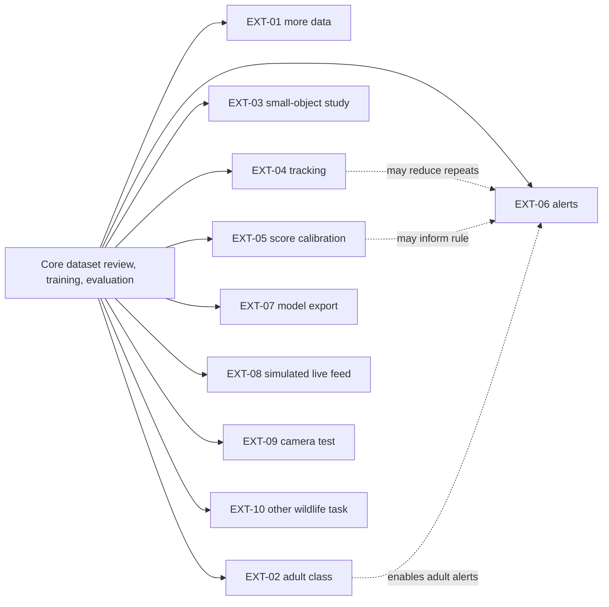

# Nazar Vision — User Feature Catalog

| Document control | Value |
| --- | --- |
| Document ID | NV-UX-002 |
| Version | 1.0, 18 October 2026 |
| Scope | User-visible and operator-facing capabilities in the graduation-project specification |
| Source | [Nazar Vision project brief](reference/Nazar_Vision_Project_Brief.pdf) |
| Status | **Specified/planned, pending audit of the existing Nazar Vision repository.** None of the entries below asserts that a feature is implemented or production-ready. |

## 1. How to read this catalog

**Core** features are required for the graduation-project proof of concept. **Optional** features are the brief's EXT-01 through EXT-10 and depend on time, data, compute, and agreed scope. **Proposed** design refinements are clearly labeled and do not come from the brief. The existing codebase must be audited first because it may contain complete, partial, or missing functionality. [Brief pp. 3–4, 17, 27–29](reference/Nazar_Vision_Project_Brief.pdf#page=3).

The principal current user is a technical reviewer or experiment operator, often a student or researcher. FiftyOne supplies the image/annotation review interface; Ultralytics supplies YOLO training and inference. The specification favors integrating established tools over building parallel editing screens. Conservation organizations are intended beneficiaries and potential future monitoring users, but operational field use is outside core completion. [Brief pp. 2–5, 8–10, 29–31](reference/Nazar_Vision_Project_Brief.pdf#page=2).

## 2. Core features — required proof of concept

| ID | User capability | User action and expected outcome | Acceptance evidence and source |
| --- | --- | --- | --- |
| NV-C01 | Import an annotated detection dataset | The operator imports the initial YOLO-format Roboflow dataset into FiftyOne. Images, boxes, labels, and original split assignments are inspectable; original image and annotation files are untouched. | Initial dataset imports with correct labels/splits and unchanged originals. [Brief pp. 5–6, 8](reference/Nazar_Vision_Project_Brief.pdf#page=5). |
| NV-C02 | Keep original and editable annotation fields separate | The reviewer sees `ground_truth_source` as the preserved reference and edits only `ground_truth_reviewed`, an initialized copy. | Boxes/classes can be corrected, added, or removed in reviewed field via FiftyOne; source field remains unchanged. [Brief pp. 8–10](reference/Nazar_Vision_Project_Brief.pdf#page=8). |
| NV-C03 | Manage training and evaluation assignments | The reviewer changes `train`, `val`, and `test` sample tags directly in FiftyOne. To remove an unsuitable sample from exports, the reviewer removes its split tag and adds `excluded`. | Exactly one assignment per image; excluded images stay available in FiftyOne and do not enter training exports. [Brief pp. 6, 9–10, 12](reference/Nazar_Vision_Project_Brief.pdf#page=6). |
| NV-C04 | Investigate dataset quality and leakage | The reviewer inspects missing/wrong boxes, duplicate or near-duplicate images, augmentations, and related source frames/events where origin data exists. | Findings and corrections are documented; leakage across splits is corrected where possible or reported as a limitation. [Brief pp. 6, 9, 12, 25–26](reference/Nazar_Vision_Project_Brief.pdf#page=6). |
| NV-C05 | Map reviewed labels into training labels | The operator configures class mapping. Initially `sea turtle` becomes `hatchling`; `non-sea-turtle` yields no positive canonical annotation. The image itself can remain as a background sample. | `ground_truth_canonical` is derived from reviewed labels without changing source/reviewed fields; unexpected classes are reported. [Brief pp. 6, 10–11](reference/Nazar_Vision_Project_Brief.pdf#page=6). |
| NV-C06 | Preview or automatically refresh canonical labels | The reviewer may explicitly regenerate canonical labels to inspect them. Every training-data export automatically regenerates them from the latest reviewed field and mapping; edits need not trigger immediate updates. | Export reflects current reviewed annotations and tag assignments even if canonical labels were temporarily stale during review. [Brief pp. 9–11](reference/Nazar_Vision_Project_Brief.pdf#page=9). |
| NV-C07 | Validate before training export | The operator starts preparation and receives a pass/fail result for exactly one assignment per image, supported classes, and valid bounding boxes. | Unassigned/conflicting tags, unknown labels, and invalid boxes are detected; export is blocked until resolved. Current `train`/`val`/`test` tags drive the result. [Brief pp. 11–12](reference/Nazar_Vision_Project_Brief.pdf#page=11). |
| NV-C08 | Preserve and recover working data | The operator can request a checkpoint and follow a documented restore procedure; the system creates a checkpoint before export. Reviewed edits, assignments, exclusions, canonical data, and metadata persist in MongoDB. | Reopen retains edits; tested restore recovers them and can resolve original image references. No backup after every edit is required. [Brief pp. 12–13, 16](reference/Nazar_Vision_Project_Brief.pdf#page=12). |
| NV-C09 | Train and reload a hatchling detector | The operator selects documented YOLO training parameters, trains on validated canonical `train`/`val` data, and loads saved weights later. | Successful training; weights, relevant settings, results, dataset state, splits, and mapping recorded sufficiently for reproduction; unseen-image inference works. [Brief pp. 13–14, 26](reference/Nazar_Vision_Project_Brief.pdf#page=13). |
| NV-C10 | Evaluate model quality and inspect errors | The operator calculates precision, recall, mAP, false positives, and false negatives; imports each run's predictions to a separate FiftyOne field; compares with canonical labels and documents representative successes/failures. | Metrics and visual review available; training choices use validation, held-out test is reserved for final assessment; results and limitations are reported. [Brief pp. 14–15, 25–27](reference/Nazar_Vision_Project_Brief.pdf#page=14). |
| NV-C11 | Run inference on prerecorded visual media | The operator loads saved weights and processes prerecorded video or a sequence of images. | Viewable annotated output shows potential hatchling boxes and confidence scores; model does not need retraining for each video. Optional machine-readable results are saved where appropriate. [Brief p. 15](reference/Nazar_Vision_Project_Brief.pdf#page=15). |
| NV-C12 | Reproduce and maintain the workflow | Another developer follows setup, review, mapping, validation, training, evaluation, inference, and backup/restore documentation; developers run the automated and code-quality checks. | Tests cover important processing, including import, mapping, split validation, export, persistence, and restore; pytest, Ruff, Black, and mypy are runnable in the supported environment. [Brief pp. 15–16](reference/Nazar_Vision_Project_Brief.pdf#page=15). |

### Core behavior that should be visible to the operator

- **Data provenance:** source annotations are distinct from corrected annotations, derived canonical labels, and run-specific predictions. This prevents a model output from being mistaken for verified ground truth. [Brief pp. 5, 8–11, 14](reference/Nazar_Vision_Project_Brief.pdf#page=5).
- **Exclusion semantics:** `non-sea-turtle` removes a positive annotation during mapping; `excluded` removes the *whole image* from export while retaining it for review. These operations must not be conflated. [Brief pp. 6, 10–12](reference/Nazar_Vision_Project_Brief.pdf#page=6).
- **Safe failure at export:** unknown classes, invalid boxes, and missing/conflicting assignment tags are reported and block export. The brief does not prescribe the exact error UI or message format. [Brief pp. 11–12](reference/Nazar_Vision_Project_Brief.pdf#page=11).
- **Reproducibility:** training outputs must be associated with the reviewed dataset state, current split tags, mapping, training configuration, and evaluation result. [Brief pp. 13–14, 26](reference/Nazar_Vision_Project_Brief.pdf#page=13).
- **Evaluation honesty:** no fixed accuracy percentage is a success criterion; public-dataset performance does not demonstrate reliable night beach monitoring. [Brief pp. 25–27, 29](reference/Nazar_Vision_Project_Brief.pdf#page=25).

## 3. Optional features — only if selected and validated

| ID | Optional user capability | Intended action/outcome | Important dependency or boundary | Source |
| --- | --- | --- | --- | --- |
| EXT-01 | Add more annotated datasets | Import further licensed, suitable data; review and map annotations with the same FiftyOne workflow; compare baseline and expanded-data results. | More data is not assumed to improve performance. Check license, quality, duplicates, and leakage. | [Brief pp. 17–18](reference/Nazar_Vision_Project_Brief.pdf#page=17) |
| EXT-02 | Distinguish adult turtles from hatchlings | Add/correct `adult_turtle` in `ground_truth_reviewed`; extend mapping; train and evaluate a two-class detector if data is sufficient. | Original `sea turtle` labels may include adults and must be reviewed. Adult detection does not determine sex or confirm nesting. | [Brief pp. 18–20](reference/Nazar_Vision_Project_Brief.pdf#page=18) |
| EXT-03 | Improve small-hatchling detection | Compare a controlled alternative (for example image resolution, tiling, augmentation, model size, or inference settings) with a documented baseline. | Report the tradeoff and effect on any adult class. | [Brief p. 20](reference/Nazar_Vision_Project_Brief.pdf#page=20) |
| EXT-04 | Track individual turtles across frames | Show track IDs, associated detections, frame counts/duration, and annotated tracked video. | Assess ID switches, overlap, disappearance, and inconsistent class labels; requires appropriate video. | [Brief pp. 20–21](reference/Nazar_Vision_Project_Brief.pdf#page=20) |
| EXT-05 | Estimate detection correctness | Assess whether model scores can be calibrated against labeled evaluation data; optionally combine evidence across a track. | Raw YOLO confidence is not automatically a probability. Correlated video frames must not be treated as independent. Reliable probabilities are not guaranteed. | [Brief pp. 21–22, 26](reference/Nazar_Vision_Project_Brief.pdf#page=21) |
| EXT-06 | Generate configurable event alerts | For a potential detection that meets a rule, produce an alert with a frame or clip; throttle repeat alerts. If EXT-02 exists, optionally distinguish hatchling and adult alerts. | Operational alerting is not core; repeated detections can cause duplicate alerts; alert means potential activity, not confirmed behavior. | [Brief pp. 22–23](reference/Nazar_Vision_Project_Brief.pdf#page=22) |
| EXT-07 | Export model to monitoring/inference software | Export a compatible artifact (for example ONNX or TensorRT) and demonstrate inference through another suitable application/runtime. | Frigate or another monitoring system compatibility must be tested, not assumed from export alone. | [Brief p. 23](reference/Nazar_Vision_Project_Brief.pdf#page=23) |
| EXT-08 | Simulate a live video feed | Feed prerecorded frames progressively at a controlled rate, observe detections, speed, and any selected tracking/alert behavior. | This is different from offline whole-file video inference and is not a physical live camera. | [Brief pp. 23–24](reference/Nazar_Vision_Project_Brief.pdf#page=23) |
| EXT-09 | Test a physical nighttime camera | Assess a camera configuration and, if hardware is available, receive and process its feed under controlled conditions. | Field performance is unproven; lighting, conservation impact, permissions, cost, and hardware constraints require assessment. | [Brief p. 24](reference/Nazar_Vision_Project_Brief.pdf#page=24) |
| EXT-10 | Adapt framework for other wildlife | Configure another annotated dataset and class mapping, then train and evaluate a task-specific model. | Goal is reusable workflow, not one universal model for every species. | [Brief pp. 24–25](reference/Nazar_Vision_Project_Brief.pdf#page=24) |

### Extension dependencies and recommended selection order

The solid arrows show that the core workflow is the foundation. The dotted arrows show useful, **not mandatory**, relationships. The specification makes hatchling detection the priority and does not require every extension. [Brief pp. 3–4, 17, 20–23, 29](reference/Nazar_Vision_Project_Brief.pdf#page=3).

## 4. What users should not be promised in the core release

| Claim to avoid | Specification boundary |
| --- | --- |
| “Users sign in to a Nazar Vision dashboard and edit annotations there.” | The review UI is FiftyOne; no custom dashboard, account system, or application permission model is specified. [Brief pp. 4–5, 8–10](reference/Nazar_Vision_Project_Brief.pdf#page=4). |
| “The system automatically monitors a live beach camera and alerts volunteers.” | Core inference uses prerecorded video or image sequences. Alerts, simulated live input, and physical cameras are EXT-06, EXT-08, and EXT-09; field deployment is beyond graduation-project completion. [Brief pp. 15, 22–24, 29–31](reference/Nazar_Vision_Project_Brief.pdf#page=15). |
| “The detector already distinguishes adults, sex, or nesting events.” | Adult class is optional EXT-02; a detected adult does not establish sex or nesting behavior. [Brief pp. 18–20](reference/Nazar_Vision_Project_Brief.pdf#page=18). |
| “A confidence score of 0.90 means a 90% chance the detection is correct.” | Calibration is optional EXT-05 and requires independent validation. [Brief pp. 21–22](reference/Nazar_Vision_Project_Brief.pdf#page=21). |
| “Good metrics on public imagery prove reliability at night on a real beach.” | The brief expressly rejects this conclusion and sets no fixed initial accuracy threshold. [Brief pp. 27, 29](reference/Nazar_Vision_Project_Brief.pdf#page=27). |

## 5. Proposed user-facing refinements for implementation review

These are **recommendations**, not existing or required features in the brief. They should be judged against the audited codebase and available project time.

1. Give each validation failure an affected sample ID, reason, and corrective action, with a summary count and an exportable list. This makes the mandatory pre-export gate practical for the dataset reviewer. [Underlying validation requirement: Brief pp. 11–12](reference/Nazar_Vision_Project_Brief.pdf#page=11).
2. Record an experiment identifier consistently across checkpoint/export, weights, evaluation metrics, and FiftyOne prediction field. This simplifies comparison without changing the required data model. [Underlying reproducibility requirement: Brief pp. 14–15, 26](reference/Nazar_Vision_Project_Brief.pdf#page=14).
3. Make annotated outputs understandable without relying solely on box color: include textual class labels and numeric confidence; provide metrics and representative errors in text/table form. The brief requires visible boxes/confidence and documented results but gives no formal accessibility target. [Underlying outputs: Brief pp. 14–16](reference/Nazar_Vision_Project_Brief.pdf#page=14).
4. Provide a concise operator checklist that confirms source preservation, the current split assignment, checkpoint creation, and test-set discipline before a major run. [Underlying requirements: Brief pp. 5, 12–15, 26](reference/Nazar_Vision_Project_Brief.pdf#page=5).

## 6. Implementation-status register for the repository audit

The following fields should be populated after reading and running the provided Nazar Vision codebase. This prevents the planned catalog from being mistaken for shipped software. The initial audit itself is required by the brief. [Brief p. 4](reference/Nazar_Vision_Project_Brief.pdf#page=4).

| Feature range | Current state | Evidence to collect |
| --- | --- | --- |
| NV-C01 to NV-C04 | **Unverified** | Existing import/review code, FiftyOne field schema, sample-tag behavior, dataset-quality workflow |
| NV-C05 to NV-C08 | **Unverified** | Mapping configuration, regeneration/export gate, persistence configuration, checkpoint/restore test |
| NV-C09 to NV-C12 | **Unverified** | Training/evaluation/inference code, saved artifacts, runnable tests and docs |
| EXT-01 to EXT-10 | **Unselected / unverified** | Explicit scope decision, available data/resources, baseline comparison, extension-specific evidence |

Update this register with precise code paths, tests, screenshots or command output, and a state such as `implemented`, `partial`, `missing`, or `deferred` after the audit. Do not mark any capability complete solely because it appears in this catalog.
