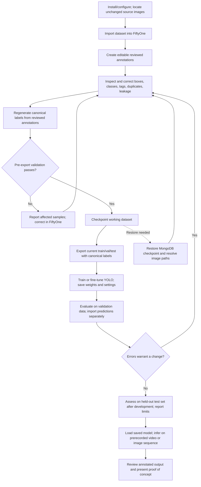

# Nazar Vision — User Usage Workflows

| Document control | Value |
| --- | --- |
| Document ID | NV-UX-001 |
| Version | 1.0, 18 October 2026 |
| Scope | Graduation-project proof of concept; sea turtle hatchling detection |
| Source | [Nazar Vision project brief](reference/Nazar_Vision_Project_Brief.pdf) |
| Status | **Specified/planned, pending audit of the existing Nazar Vision repository.** This document describes required behavior, not verified current behavior. |

## 1. Purpose and boundaries

This document describes what a person does to prepare data, train and assess a hatchling detector, and inspect its predictions on prerecorded footage. The working interface for image and annotation review is the **FiftyOne App**. Training, export, evaluation, backup, and inference are Nazar Vision Python workflows using established libraries; the project brief does not require a custom web dashboard, login system, or distinct application accounts. Operational alerts and camera monitoring are optional extensions. [Brief pp. 3–5](reference/Nazar_Vision_Project_Brief.pdf#page=3), [pp. 8–16](reference/Nazar_Vision_Project_Brief.pdf#page=8), [p. 29](reference/Nazar_Vision_Project_Brief.pdf#page=29).

The terms **user action** and **system result** below express intended requirements. Concrete command names, screens outside FiftyOne, deployment packaging, and implementation status must be confirmed during the repository audit. The source brief expressly requires this audit before determining what is complete. [Brief p. 4](reference/Nazar_Vision_Project_Brief.pdf#page=4).

## 2. People and access context

| Actor | Current or future role | Uses the proof of concept to... | Boundary |
| --- | --- | --- | --- |
| Dataset reviewer / curator | Core workflow user; likely a student or researcher | Inspect images and boxes, correct `ground_truth_reviewed`, assign `train`/`val`/`test`/`excluded`, investigate leakage | The brief defines work, not a separate account or permission role. [Brief pp. 8–10](reference/Nazar_Vision_Project_Brief.pdf#page=8). |
| Model experiment operator | Core workflow user; may be the same person as the reviewer | Validate/export data; configure, train, evaluate, compare, and run inference | The test partition is reserved for final independent assessment. [Brief pp. 7, 13–15](reference/Nazar_Vision_Project_Brief.pdf#page=7). |
| Developer / reproducing reviewer | Core documentation audience | Install, test, restore, and reproduce an experiment | This is a usage persona, not an authorization level. [Brief pp. 15–16](reference/Nazar_Vision_Project_Brief.pdf#page=15). |
| Conservation volunteer or organization | Future stakeholder / possible extension user | Review potential activity alerts or field evidence if monitoring is developed | Alerting and field deployment are **not** core deliverables. A human response or verification process is a proposed future practice, not specified software behavior. [Brief pp. 1–3, 22, 29–31](reference/Nazar_Vision_Project_Brief.pdf#page=1). |

## 3. Dataset and output vocabulary

| Item | Meaning | Change rule |
| --- | --- | --- |
| Source image and annotation files | Imported public dataset originals | Preserve unchanged. [Brief pp. 5–8](reference/Nazar_Vision_Project_Brief.pdf#page=5). |
| `ground_truth_source` | Imported annotation record in FiftyOne | Read-only reference. [Brief pp. 8–9](reference/Nazar_Vision_Project_Brief.pdf#page=8). |
| `ground_truth_reviewed` | Editable copy used for corrections and additions | Persist edits in FiftyOne/MongoDB. [Brief pp. 8–10](reference/Nazar_Vision_Project_Brief.pdf#page=8). |
| Assignment tag | Exactly one of `train`, `val`, `test`, `excluded` per image | `excluded` images remain in FiftyOne and leave every training export. Unassigned/conflicting samples block export. [Brief pp. 9, 12](reference/Nazar_Vision_Project_Brief.pdf#page=9). |
| `ground_truth_canonical` | Derived training labels mapped from reviewed labels | May be stale during review; regenerate on explicit request and automatically on every training-data export. [Brief pp. 10–11](reference/Nazar_Vision_Project_Brief.pdf#page=10). |
| `predictions_run_001` etc. | Separate model-prediction field per experiment | Must not overwrite reviewed or source annotations. The field name is illustrative. [Brief p. 14](reference/Nazar_Vision_Project_Brief.pdf#page=14). |
| Experiment record | Dataset state/checkpoint, class mapping, training settings, weights, results | Retain enough to reproduce significant runs. [Brief pp. 13–15, 26](reference/Nazar_Vision_Project_Brief.pdf#page=13). |

## 4. End-to-end core journey

An editable version of this diagram is available as [Nazar_Vision_Core_User_Workflow.mmd](diagrams/Nazar_Vision_Core_User_Workflow.mmd).

The review activities can occur in any order. Export is a gate: it must use the latest reviewed annotations and current tags, regenerate canonical labels, and omit excluded samples. Development decisions use training/validation data; the test set is held out for final assessment. [Brief pp. 7, 9–15](reference/Nazar_Vision_Project_Brief.pdf#page=7).

### W-01 — Set up and import a dataset

**Goal:** Open a persistent, inspectable working dataset without changing the source dataset. **Primary actor:** dataset reviewer. **Entry conditions:** supported Python/dependencies and MongoDB/FiftyOne environment are available; the initial Roboflow export and source images are locally accessible. Installation and configuration instructions are required project documentation. [Brief pp. 4–6, 8, 16](reference/Nazar_Vision_Project_Brief.pdf#page=4).

| Step | User action | Required system result / evidence |
| --- | --- | --- |
| 1 | Configure the project for the initial YOLO-format dataset and identify the source image location. | Source paths resolve; no original files are rewritten. [Brief pp. 5–8](reference/Nazar_Vision_Project_Brief.pdf#page=5). |
| 2 | Run the dataset import workflow. | Images, bounding boxes, labels, and existing `train`/`val`/`test` assignments appear in FiftyOne; original labels populate `ground_truth_source`. [Brief p. 8](reference/Nazar_Vision_Project_Brief.pdf#page=8). |
| 3 | Initialize the reviewed annotation field and persistence. | `ground_truth_reviewed` is an editable copy; `ground_truth_source` remains unchanged; the FiftyOne dataset is persistent. [Brief pp. 8–9, 12](reference/Nazar_Vision_Project_Brief.pdf#page=8). |
| 4 | Close and reopen the working dataset. | Images, labels, and tags remain available, proving persistence across sessions. [Brief pp. 12–13](reference/Nazar_Vision_Project_Brief.pdf#page=12). |

**Alternate paths:** If the source is already imported, reopen the persistent dataset and verify its annotation fields and image paths before continuing. If additional public data is used, that is EXT-01 and requires license, quality, duplicate, and mapping checks. [Brief pp. 7, 12–13, 17–18](reference/Nazar_Vision_Project_Brief.pdf#page=7).

**Exception paths:** If image references are broken, stop review/export and correct the source path or restore the required source image location. If import loses boxes, labels, or split assignments, treat it as an import defect and do not train. These are proposed safe operator responses to the source-preservation and import acceptance criteria. [Brief pp. 8, 13](reference/Nazar_Vision_Project_Brief.pdf#page=8).

### W-02 — Review data and decide sample assignments

**Goal:** Produce trustworthy reviewed annotations and partitions. **Primary actor:** dataset reviewer. **Entry condition:** W-01 has created `ground_truth_reviewed`. [Brief pp. 6, 8–10](reference/Nazar_Vision_Project_Brief.pdf#page=6).

| Step | User action | Required system result / evidence |
| --- | --- | --- |
| 1 | In FiftyOne, compare an image and its boxes/labels in source and reviewed fields. | Source stays available as an immutable reference. [Brief pp. 8–9](reference/Nazar_Vision_Project_Brief.pdf#page=8). |
| 2 | Correct mispositioned boxes and wrong classes; add missed hatchlings; remove wrong detections in `ground_truth_reviewed`. | Reviewed edits persist; originals remain unchanged. [Brief pp. 8–10](reference/Nazar_Vision_Project_Brief.pdf#page=8). |
| 3 | Inspect duplicates, near duplicates, augmentations, and any known event/video origin across partitions. | Suspected training-to-evaluation leakage is corrected where possible or documented. [Brief pp. 6, 12, 25–26](reference/Nazar_Vision_Project_Brief.pdf#page=6). |
| 4 | Set exactly one assignment tag per image. For an unsuitable image, remove its current split tag and apply `excluded`. | Excluded image remains viewable in FiftyOne and is omitted from export. [Brief pp. 6, 9–10, 12](reference/Nazar_Vision_Project_Brief.pdf#page=6). |
| 5 | Reopen the dataset or inspect a saved view to verify corrections and tags. | Reviewed state is retained in MongoDB. [Brief pp. 9–10, 12–13](reference/Nazar_Vision_Project_Brief.pdf#page=9). |

**Alternate paths:** A valid `train`/`val`/`test` image with no positive hatchling annotation may be retained as a background example. An image whose source `sea turtle` label is actually an adult must be relabeled correctly in reviewed annotations, investigated, or excluded; it must not silently become a hatchling. Review order is flexible. [Brief pp. 6, 9, 11, 18](reference/Nazar_Vision_Project_Brief.pdf#page=6).

**Exception paths:** Unassigned or multiply tagged images are resolved before export. Where duplicate/related images span splits, reassign affected images to prevent leakage where possible and document residual uncertainty. If a reviewer cannot determine life stage reliably, investigate further or exclude the uncertain sample from training and evaluation. [Brief pp. 12, 18, 25–26](reference/Nazar_Vision_Project_Brief.pdf#page=12).

### W-03 — Prepare, validate, checkpoint, and train

**Goal:** Create an auditable training export and saved detector. **Primary actor:** experiment operator. **Entry condition:** W-02 has a reviewed dataset and configured class mapping. [Brief pp. 10–14](reference/Nazar_Vision_Project_Brief.pdf#page=10).

| Step | User action | Required system result / evidence |
| --- | --- | --- |
| 1 | Inspect the mapping configuration, initially `sea turtle` → `hatchling` and `non-sea-turtle` → excluded annotation. | Mapping is recorded with the experiment; excluding that annotation does not remove the image. [Brief pp. 6, 10–11](reference/Nazar_Vision_Project_Brief.pdf#page=6). |
| 2 | Request a preview regeneration if desired; otherwise start preparation/export. | Canonical labels are regenerated automatically from the latest `ground_truth_reviewed` on every training-data export. Source and reviewed fields do not change. [Brief pp. 10–11](reference/Nazar_Vision_Project_Brief.pdf#page=10). |
| 3 | Review the pre-export validation outcome. | All samples have exactly one assignment; canonical boxes and classes are valid; unexpected labels are reported. Invalid data blocks export. [Brief pp. 11–12](reference/Nazar_Vision_Project_Brief.pdf#page=11). |
| 4 | Proceed after validation passes. | A MongoDB checkpoint is created before export; only `train`/`val`/`test` images and current canonical annotations go to the YOLO export. [Brief pp. 12–14](reference/Nazar_Vision_Project_Brief.pdf#page=12). |
| 5 | Select documented training parameters and train or fine-tune the chosen Ultralytics YOLO model. | Saved model weights, configuration, training results, dataset state or export, and split/mapping information allow the run to be reproduced. [Brief pp. 13–14, 26](reference/Nazar_Vision_Project_Brief.pdf#page=13). |

**Alternate paths:** A background image with zero canonical boxes remains a valid exported image if it has a valid split tag. A user may explicitly regenerate `ground_truth_canonical` solely to inspect labels in FiftyOne. [Brief p. 11](reference/Nazar_Vision_Project_Brief.pdf#page=11).

**Exception paths:** A missing/conflicting assignment, invalid bounding box, or unexpected class stops export; the operator uses reported affected records to correct the reviewed data/tags/configuration and reruns validation. If an experiment is interrupted, restart from the saved dataset/export and recorded settings as appropriate; do not treat partial weights as a completed result. The latter restart rule is a proposed operational safeguard. [Brief pp. 11–14, 26](reference/Nazar_Vision_Project_Brief.pdf#page=11).

### W-04 — Evaluate, inspect errors, iterate, and finalize

**Goal:** Produce credible metrics and understand failure modes. **Primary actor:** experiment operator. **Entry condition:** a model from W-03 can be reloaded. [Brief pp. 14–15, 25–27](reference/Nazar_Vision_Project_Brief.pdf#page=14).

| Step | User action | Required system result / evidence |
| --- | --- | --- |
| 1 | Evaluate on validation data during development. | Record precision, recall, mAP, false positives, and false negatives. [Brief pp. 14–15, 25](reference/Nazar_Vision_Project_Brief.pdf#page=14). |
| 2 | Import predictions to a separate run-specific FiftyOne field. | Prediction boxes are visually comparable with canonical ground truth, without modifying original/reviewed labels. [Brief p. 14](reference/Nazar_Vision_Project_Brief.pdf#page=14). |
| 3 | Review true positives, missed hatchlings, false detections, poor box placement, and difficult size/lighting/background cases. | Document representative errors and limitations. [Brief pp. 14–15, 25](reference/Nazar_Vision_Project_Brief.pdf#page=14). |
| 4 | If a label or split problem is found, correct `ground_truth_reviewed` or tags; if a model problem is found, change a documented training setting or data selection. | Next export regenerates canonical labels; rerun training and compare with the prior run under a consistent evaluation method. [Brief pp. 7, 11, 14–15](reference/Nazar_Vision_Project_Brief.pdf#page=7). |
| 5 | After development choices are fixed, assess the held-out test set and record final findings. | Report results and limitations without claiming nighttime field reliability. There is no fixed required accuracy percentage. [Brief pp. 15, 27, 29](reference/Nazar_Vision_Project_Brief.pdf#page=15). |

**Alternate paths:** If no meaningful improvement is demonstrated, retain the documented baseline and report the comparison. If adult detection (EXT-02) is undertaken, evaluate each class separately and examine cross-class confusion. [Brief pp. 19–20, 25](reference/Nazar_Vision_Project_Brief.pdf#page=19).

**Exception paths:** Evidence of test leakage requires correcting splits where possible and repeating the affected evaluation. An annotation error seen during prediction review is fixed in `ground_truth_reviewed`, followed by canonical regeneration before further training/evaluation. Avoid repeatedly tuning choices against held-out test data; this is the practical consequence of reserving test data for final assessment. [Brief pp. 14–15, 25–26](reference/Nazar_Vision_Project_Brief.pdf#page=14).

### W-05 — Review hatchling detections on prerecorded footage

**Goal:** Demonstrate frame-level inference using a saved model. **Primary actor:** experiment operator or demonstrator. **Entry condition:** saved model weights and a prerecorded video or image sequence are available. [Brief p. 15](reference/Nazar_Vision_Project_Brief.pdf#page=15).

| Step | User action | Required system result / evidence |
| --- | --- | --- |
| 1 | Select and load a saved trained model. | Model is usable without retraining for each video. [Brief p. 15](reference/Nazar_Vision_Project_Brief.pdf#page=15). |
| 2 | Select prerecorded footage or, if genuine video is unavailable, an image sequence. | Frames are processed one by one and potential hatchlings detected. [Brief p. 15](reference/Nazar_Vision_Project_Brief.pdf#page=15). |
| 3 | Inspect generated output. | Annotated frames/video show bounding boxes and model confidence scores; machine-readable results may be saved where appropriate. [Brief p. 15](reference/Nazar_Vision_Project_Brief.pdf#page=15). |
| 4 | Present examples along with evaluation results and known limitations. | Audience sees a proof of concept, not a verified field alarm system. [Brief pp. 27–29](reference/Nazar_Vision_Project_Brief.pdf#page=27). |

**Alternate paths:** If only image sequences are used, state this limitation in the demonstration. Tracking, event deduplication, alerting, progressive simulated live input, and physical camera feeds are separate extensions. [Brief pp. 15, 20–24](reference/Nazar_Vision_Project_Brief.pdf#page=15).

**Exception paths:** If the saved model or video cannot be read, stop with an explicit input/model loading failure and preserve the original media. This is a proposed operator response consistent with the model-reload and video acceptance criteria. [Brief pp. 14–15](reference/Nazar_Vision_Project_Brief.pdf#page=14).

### W-06 — Recover the reviewed dataset from a checkpoint

**Goal:** Prove that valuable review work can be recovered. **Primary actor:** developer or dataset reviewer. **Entry condition:** a MongoDB backup/checkpoint and the corresponding unmodified source images are available. [Brief pp. 12–13, 16](reference/Nazar_Vision_Project_Brief.pdf#page=12).

1. Identify the checkpoint associated with the desired experiment or major review milestone. Periodic backups and automatic pre-export checkpoints are required; there is no requirement to back up after every edit. [Brief pp. 12–13, 26](reference/Nazar_Vision_Project_Brief.pdf#page=12).
2. Restore MongoDB by the project's documented procedure, then reopen the persistent FiftyOne dataset. [Brief pp. 12–13, 16](reference/Nazar_Vision_Project_Brief.pdf#page=12).
3. Check representative reviewed boxes/classes, all assignment and exclusion tags, generated canonical metadata, and other relevant data. Verify that referenced image files still resolve. [Brief pp. 12–13](reference/Nazar_Vision_Project_Brief.pdf#page=12).
4. If image paths do not resolve, recover the unchanged source images or correct the documented path mapping before relying on the restored dataset. This is a proposed recovery response to the explicit image-reference requirement. [Brief p. 13](reference/Nazar_Vision_Project_Brief.pdf#page=13).

**Exit evidence:** a tested restore produces the expected labels, tags, metadata, and accessible images. [Brief p. 13](reference/Nazar_Vision_Project_Brief.pdf#page=13).

## 5. Optional future monitoring journey — separate from the core

If EXT-06 is selected, a prototype may process frames, detect a potential turtle, check a configurable rule, generate an alert, and save a frame or short clip. It must control repeat frequency; tracking (EXT-04) and calibrated/track-level confidence (EXT-05) may inform the rule if implemented and validated. Different class alerts require EXT-02. Any conservation-volunteer review, escalation, or on-site response is a **proposed human procedure**; it is not a specified core software feature. A model detection represents potential activity and does not confirm nesting behavior. [Brief pp. 20–23](reference/Nazar_Vision_Project_Brief.pdf#page=20).

## 6. Usability and accessibility recommendations — proposed, not brief requirements

The brief requires documentation another developer can follow but does not set a formal accessibility standard or certify FiftyOne's accessibility. The following are **proposed design checks**, to be evaluated against the actual interfaces during implementation. [Brief pp. 15–16](reference/Nazar_Vision_Project_Brief.pdf#page=15).

- Make documented setup and workflow steps copyable, ordered, and clear about prerequisites and outputs.
- Make validation errors identify sample IDs, problematic tags/classes/boxes, and the correction needed. This is a recommended presentation of the required validation failures.
- Include class text and numeric confidence alongside box color in annotated output; do not rely on color alone.
- Provide metrics and important error cases in text or exportable tables as well as visual overlays.
- Test the actual FiftyOne-based review flow with keyboard and assistive technology where practical before making any accessibility conformance claim.
- Explain that model confidence is a score, not a calibrated probability of correctness unless EXT-05 has been validated. [Brief pp. 21–22](reference/Nazar_Vision_Project_Brief.pdf#page=21).

## 7. Completion evidence and open questions

| Evidence at handover | Source expectation |
| --- | --- |
| Persistent, corrected FiftyOne dataset with original annotations intact | [Brief pp. 8–10, 12–13](reference/Nazar_Vision_Project_Brief.pdf#page=8) |
| Validation/export results, checkpoint and demonstrated restore | [Brief pp. 11–14](reference/Nazar_Vision_Project_Brief.pdf#page=11) |
| Reloadable model, training settings, data state, metrics, representative errors | [Brief pp. 13–15, 26–27](reference/Nazar_Vision_Project_Brief.pdf#page=13) |
| Annotated prerecorded video or image-sequence demonstration | [Brief pp. 15, 27–29](reference/Nazar_Vision_Project_Brief.pdf#page=15) |
| Tests, operator documentation, reproducible experiment instructions | [Brief pp. 15–16, 27](reference/Nazar_Vision_Project_Brief.pdf#page=15) |

Before translating these flows into exact commands and screenshots, audit the existing repository and settle the supported environment, available compute, ownership of student contributions, and any selected optional extensions. The brief leaves those matters to initial project planning. [Brief pp. 4, 28–30](reference/Nazar_Vision_Project_Brief.pdf#page=4).
